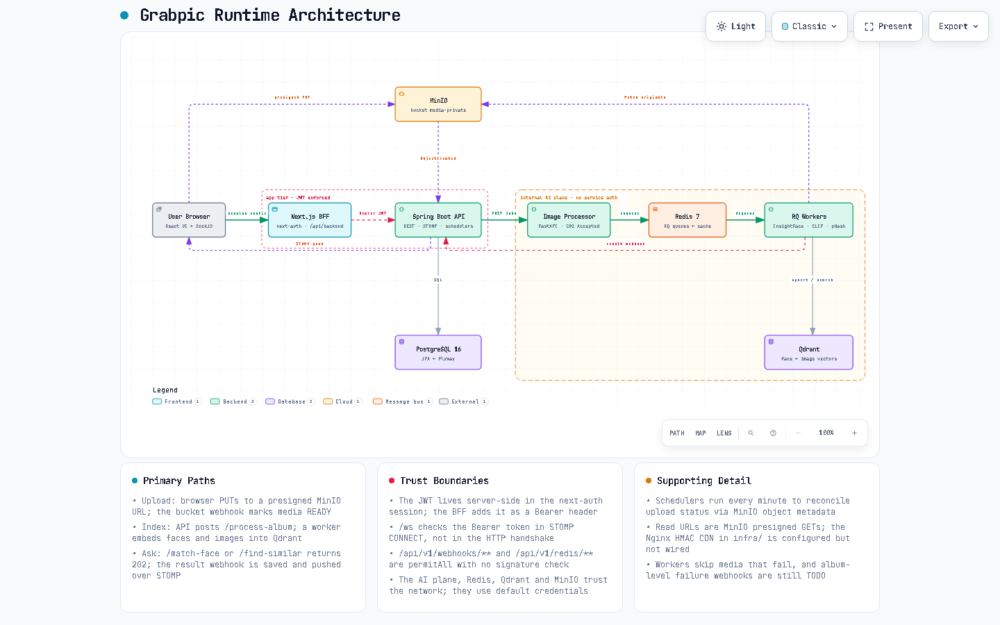
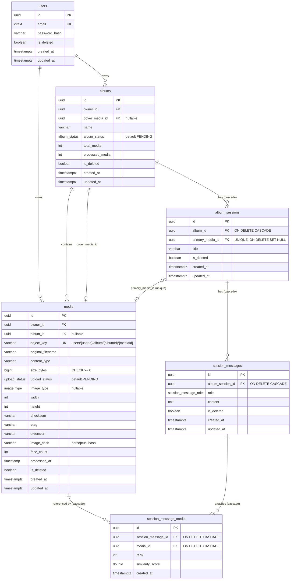

# Grabpic

Grabpic is a photo album app with an AI assistant. You upload an album, Grabpic indexes every face and image, and then you can ask questions in a chat session such as "find every photo of this person" (face match) or "photos at the beach" (text-to-image search).

| Part | Path | Stack | Port |
|---|---|---|---|
| Web client + BFF | [`grabpic-client/`](grabpic-client) | Next.js 15, React, next-auth, SockJS/STOMP | 3000 |
| API | [`grabpic/`](grabpic) | Spring Boot 3.5 (Java 17), JPA, Flyway, Spring Security (JWT), STOMP WebSocket | 8081 |
| Image processor | [`image-processor/`](image-processor) | FastAPI, RQ workers, InsightFace (`buffalo_l`), CLIP, pHash | 8002 |
| Infrastructure | [`infra/`](infra) | Docker Compose: PostgreSQL 16, Redis 7, MinIO, Qdrant 1.15, Nginx, RedisInsight | see below |

---

## Architecture



Interactive version: [`docs/grabpic-runtime.html`](docs/grabpic-runtime.html) (open it in a browser; it supports pan/zoom, search, tracing, themes and export). Source spec: [`docs/grabpic-runtime.architecture.json`](docs/grabpic-runtime.architecture.json), rendered with [archify](https://github.com/tt-a1i/archify).

### Primary paths

1. **Sign-in and API calls.** The browser talks only to the Next.js server. `next-auth` logs in against `POST /api/v1/auth/login` and keeps the JWT inside its server-side session. The `/api/backend/[...path]` route forwards requests to `/api/v1/**` with `Authorization: Bearer <jwt>`.
2. **Upload.** The API issues presigned PUT URLs. The browser uploads straight to MinIO (bucket `media-private`), and MinIO's bucket notification calls `POST /api/v1/webhooks/minio`, which marks the media `READY`. Schedulers that run every minute reconcile any uploads the webhook missed, using the object metadata.
3. **Indexing.** The API calls `POST /process-album` on the image processor, which replies `202` and queues the job on RQ (`album-processing`). A worker downloads each original from MinIO, detects faces (InsightFace), computes CLIP embeddings and a perceptual hash, and upserts the vectors into Qdrant.
4. **Ask a session.** `POST /match-face` (`face_search_queue`) or `POST /find-similar` (`image_search_queue`) returns `202`. The worker searches Qdrant, then posts the matching media IDs to `POST /api/v1/webhooks/process`. The API saves an `ASSISTANT` message and pushes it to `/topic/sessions/{sessionId}/messages`.
5. **Realtime.** The browser gets its access token from `/api/socket-token` and connects SockJS/STOMP directly to the API at `/ws`. The token is checked on the STOMP `CONNECT` frame.

### Trust boundaries

- **App tier (JWT enforced):** covers the Next.js server and the Spring API. Every `/api/v1/**` route requires a valid JWT except `auth/**`, `webhooks/**`, `redis/**`, `/ws` (the handshake only) and Swagger.
- **Internal AI plane (no service auth):** the image processor, Redis/RQ, the workers and Qdrant trust the network, and MinIO uses root credentials.

> ⚠️ **Security notes before deploying anywhere public**
> - `/api/v1/webhooks/**` and `/api/v1/redis/**` are `permitAll` with no signature or shared-secret check, so anyone who can reach the API can post fake results or read and write Redis.
> - All default credentials (Postgres `admin/12345`, MinIO `admin/12345678`, `JWT_SECRET`) are development values; override them through environment variables.
> - The Nginx signed-link image server in `infra/nginx/nginx.conf` is configured but not wired up yet; images are currently served as MinIO presigned GET URLs.

---

## Database schema

PostgreSQL, managed by Flyway migrations in [`grabpic/src/main/resources/db/migration`](grabpic/src/main/resources/db/migration) (`V1`–`V6`). Hibernate runs with `ddl-auto: validate`, so the migrations are the source of truth.



**Enums**

| Type | Values |
|---|---|
| `upload_status` | `PENDING`, `UPLOADED`, `PROCESSING`, `READY`, `FAILED`, `DELETED`, `UPLOAD_FAILED`, `PROCESSING_FAILED`, `PROCESSED`, `EXPIRED` |
| `album_status` | `PENDING`, `UPLOADING`, `READY_FOR_PROCESSING`, `PROCESSING`, `PROCESSED`, `FAILED` |
| `image_type` | `PRIMARY`, `COVER`, `GALLERY`, `PROFILE` |
| `session_message_role` | `USER`, `ASSISTANT` |

**Constraints and indexes**

| Table | Constraint / index |
|---|---|
| `users` | `UNIQUE (email)`, case-insensitive via `citext` |
| `media` | `UNIQUE (object_key)`; `idx_media_owner_active_created (owner_id, is_deleted, created_at DESC)`; partial `idx_media_gallery_by_album (album_id, image_type, upload_status) WHERE is_deleted = FALSE` |
| `album_sessions` | `UNIQUE (primary_media_id)` |
| `session_messages` | `idx_session_messages_session_created (album_session_id, created_at)` |
| `session_message_media` | `UNIQUE (session_message_id, media_id)`; `idx_session_message_media_message_rank (session_message_id, rank)` |

Every primary key is a `UUID` defaulting to `gen_random_uuid()` (`pgcrypto`). Most tables soft-delete with `is_deleted`.

### Vector store (Qdrant)

The image processor creates these collections on startup (`QdrantService.ensure_collection`):

| Collection | Vector | Point ID | Payload |
|---|---|---|---|
| `faces` | 512-d, cosine (InsightFace) | random UUID, one point per detected face | `media_id`, `album_id`, `bbox`, `hash`, `confidence`, `age`, `gender`, `model`, `face_index`, `cluster_id` (optional) |
| `images` | 512-d, cosine (CLIP) | `media_id` | `media_id`, `album_id`, `hash`, `model` |

Searches are always filtered by `album_id`.

### Object storage (MinIO)

```
media-private/
└── users/{userId}/album/{albumId}/{mediaId}
```

---

## Running locally

**Prerequisites:** Docker, Java 17 + Maven, Node.js 20+, Python 3.10+.

```bash
# 1. Infrastructure (Postgres, Redis, MinIO, Qdrant, Nginx, RedisInsight)
docker compose -f infra/docker-compose.yml up -d
```

MinIO's bucket webhook is hard-coded to `http://172.31.192.1:8081/api/v1/webhooks/minio` in `infra/docker-compose.yml`. Change it to an address where the container can reach your host API (for example `host.docker.internal`).

```bash
# 2. API (runs Flyway migrations on startup)  → http://localhost:8081
cd grabpic && ./mvnw spring-boot:run
```

```bash
# 3. Image processor API  → http://localhost:8002
cd image-processor
python -m venv venv && venv\Scripts\activate    # on macOS/Linux: source venv/bin/activate
pip install -r requirements.txt
uvicorn app.main:app --reload --port 8002
```

```bash
# 4. RQ workers (one per queue, each in its own terminal; SimpleWorker is needed on Windows)
rq worker --worker-class rq.worker.SimpleWorker album-processing
rq worker --worker-class rq.worker.SimpleWorker face_search_queue
rq worker --worker-class rq.worker.SimpleWorker image_search_queue
```

```bash
# 5. Web client  → http://localhost:3000
cd grabpic-client && npm install && npm run dev
```

### Configuration

| Service | Variable | Default |
|---|---|---|
| API | `SPRING_DATASOURCE_URL` / `_USERNAME` / `_PASSWORD` | `jdbc:postgresql://localhost:5432/grabpic`, `admin`, `12345` |
| API | `STORAGE_ENDPOINT`, `STORAGE_ACCESS_KEY`, `STORAGE_SECRET_KEY`, `STORAGE_BUCKET` | `http://localhost:9000`, `admin`, `12345678`, `media-private` |
| API | `REDIS_HOST`, `REDIS_PORT`, `REDIS_PASSWORD` | `localhost`, `6379`, empty |
| API | `JWT_SECRET` | dev-only value, **override it** |
| API | `IMAGE_PROCESSOR_URL` | `http://localhost:8002` |
| API | `app.cors.allowed-origins` | `http://localhost:3000` |
| Client | `BACKEND_URL`, `AUTH_SECRET` | set in `grabpic-client/.env` |
| Image processor | `REDIS_HOST`, `MINIO_ENDPOINT`, `MINIO_ACCESS_KEY`, `MINIO_SECRET_KEY`, `MINIO_BUCKET`, `QDRANT_HOST`, `QDRANT_PORT`, `BACKEND_WEBHOOK_URL` | see `image-processor/app/core/config.py` (loads `.env`) |

### Useful URLs

| What | URL |
|---|---|
| Swagger UI | http://localhost:8081/swagger-ui/index.html |
| MinIO console | http://localhost:9001 |
| Qdrant dashboard | http://localhost:6333/dashboard |
| RedisInsight | http://localhost:5540 |

---

## Repository layout

```
grabpic/
├── grabpic/            Spring Boot API (auth, media, album, session, storage, webhook, config)
├── grabpic-client/     Next.js web client + BFF routes (app/api/auth, app/api/backend, app/api/socket-token)
├── image-processor/    FastAPI + RQ workers (api/, core/, services/, workers/)
├── infra/              docker-compose.yml, nginx/nginx.conf
├── docs/               Architecture diagram (HTML, PNG, archify spec)
└── data/               Sample images for manual testing
```
